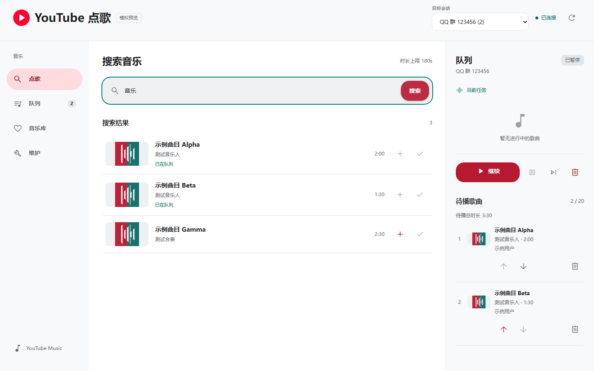
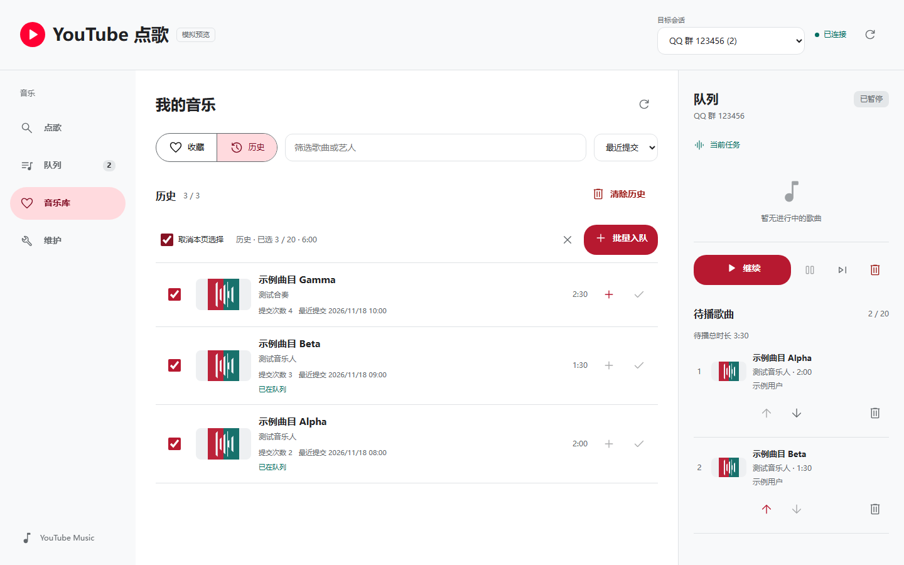
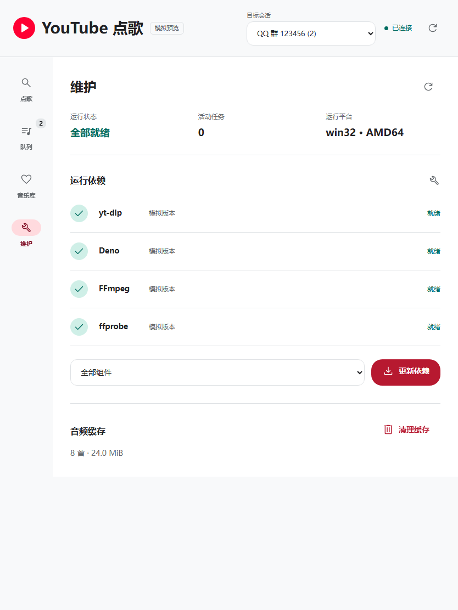
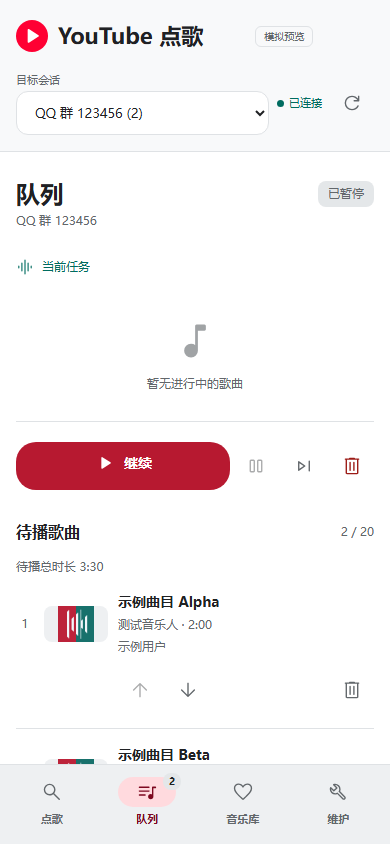

# AstrBot YouTube Music

[](https://github.com/pakhozako/astrbot_plugin_youtube_music/actions/workflows/ci.yml)
[](CHANGELOG.md)
[](LICENSE)

**在 QQ 群聊中选歌、排队，以语音分享音乐。**

搜索 YouTube 歌曲、选择候选并加入群聊共享队列，以语音分享音乐。Material Design 3 控制台将搜索、队列、收藏、历史与依赖维护集中在一个清晰的界面中。

A YouTube music request plugin for AstrBot, with shared QQ queues and a Material 3 console.

[文档目录](docs/index.md) · [使用指南](docs/USAGE.md) · [问题反馈](https://github.com/pakhozako/astrbot_plugin_youtube_music/issues)

## 核心功能

- **搜索点歌**：多关键词与版本识别，分页查看候选，按编号或 YouTube 分享链接点歌；详情按需展示封面。
- **群聊隔离**：搜索列表属于当前用户和群聊；可用结果码绑定选歌，重新搜索和取消搜索不影响其他成员。
- **共享队列**：展示点歌者、处理阶段和待播总时长，也可只查询自己的歌曲；支持暂停、继续、下一首、取消、移除和调整顺序。
- **个人重播**：从自己的最近语音历史重播，或从个人收藏与历史中随机点歌。
- **音乐库**：分页浏览收藏与语音提交历史，稳定的聊天收藏编号，跨页选择最多 20 首并整批入队；当前曲目与已排队歌曲明确标记。
- **搜索结果自动撤回**：按配置的延迟清理搜索结果消息。
- **AI Tool**：通过 `youtube_music` 在对话中搜索和管理当前会话的音乐队列。
- **响应式控制台**：桌面、平板和手机布局，亮暗主题与中英文跟随 AstrBot。
- **依赖维护**：检查和更新 yt-dlp、Deno、FFmpeg，查看进度、取消任务并清理缓存。

## 界面

桌面搜索与共享队列：

[](docs/images/desktop-search.png)

音乐库与批量点歌：

[](docs/images/desktop-library.png)

<details>
<summary>查看平板和手机界面</summary>

| 平板维护 | 手机队列 |
| --- | --- |
| [](docs/images/tablet-maintenance.png) | [](docs/images/mobile-queue.png) |

</details>

## 快速安装

1. 在 AstrBot **插件** 页面点击 **安装插件 → 从链接安装**。
2. 输入仓库地址并完成安装：

   ```text
   https://github.com/pakhozako/astrbot_plugin_youtube_music
   ```

3. 按[依赖指南](docs/DEPENDENCIES.md)准备运行程序，再从插件详情打开 `console`，在 **维护** 页面检查状态。

手动安装和 ZIP 安装见[安装指南](docs/INSTALLATION.md)。

## 首次使用

在已接入 AstrBot 的 QQ 会话中依次发送：

```text
/点歌 帮助
/点歌 piano
/点歌 1
/点歌 队列
```

搜索后按照实际结果选择编号。打开控制台，选择刚才使用的会话，即可查看队列、收藏歌曲和管理依赖。

接下来可以阅读[完整指令和控制台用法](docs/USAGE.md)，或在 AstrBot 插件配置页按[配置参考](docs/CONFIGURATION.md)调整搜索、音频、队列和撤回参数。

## 文档

| 文档 | 内容 |
| --- | --- |
| [安装](docs/INSTALLATION.md) | 从仓库或 ZIP 安装、更新插件 |
| [使用](docs/USAGE.md) | QQ 指令、控制台、音乐库、AI Tool |
| [配置](docs/CONFIGURATION.md) | 全部配置字段、默认值、范围和示例 |
| [依赖](docs/DEPENDENCIES.md) | 运行程序、下载来源、安装和更新 |
| [故障排查](docs/TROUBLESHOOTING.md) | 检查顺序、常见问题、数据备份和恢复 |
| [开发](https://github.com/pakhozako/astrbot_plugin_youtube_music/blob/main/docs/DEVELOPMENT.md) | 环境、架构、测试、构建和截图 |
| [安全](https://github.com/pakhozako/astrbot_plugin_youtube_music/blob/main/SECURITY.md) | 权限、部署建议和漏洞报告 |
| [贡献](https://github.com/pakhozako/astrbot_plugin_youtube_music/blob/main/CONTRIBUTING.md) | 问题反馈、变更流程和 Pull Request |

## 开源

[MIT License](LICENSE) · Copyright (c) 2026 pakhozako。

[更新记录](CHANGELOG.md) · [第三方许可](THIRD_PARTY_NOTICES.md)
